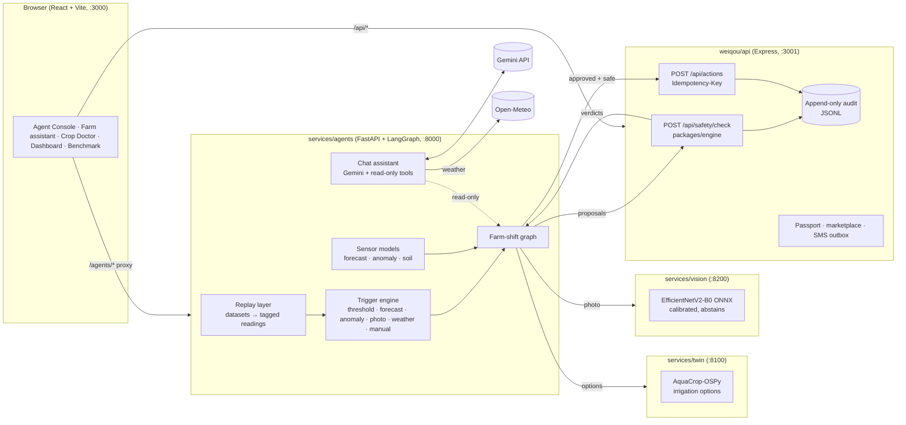
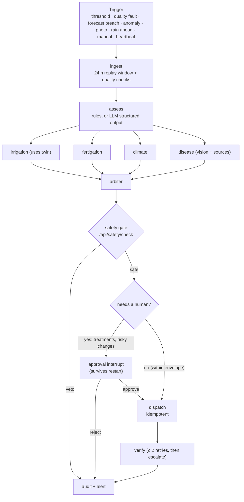
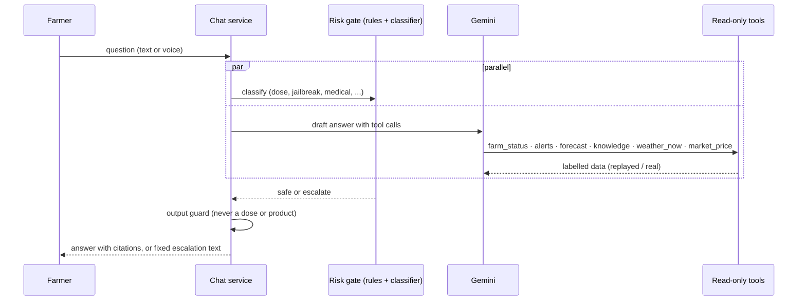

# Solarda: Agentic Smart Agriculture

> Safety-gated AI farm agents, a multilingual farm assistant, a plant-disease vision model and learned sensor forecasting, built on the TerraSub & Solar-Da precision-agriculture platform.
> Built for the **Agentic AI Hackathon 2026**.

| | |
|---|---|
| **Live demo** | `ADD_DEPLOYMENT_LINK_HERE` (see [Deployment](#deployment)) |
| **Demo script** | [`docs/DEMO.md`](docs/DEMO.md) |
| **Evidence (every number, with its source file)** | [`evidence/README.md`](evidence/README.md) |
| **What is real vs UI-only** | [`docs/AUDIT.md`](docs/AUDIT.md) |

> **Data honesty.** There are no live farm sensors. Every reading shown comes from the replay layer (public datasets), the crop twin or a simulation, and is tagged with its source. Weather in the chat assistant is the one real, live feed (Open-Meteo). Nothing replayed is ever presented as live.

---

## Contents
1. [The idea](#the-idea) 2. [Features](#features) 3. [System architecture](#system-architecture) 4. [Workflow of one farm shift](#workflow-of-one-farm-shift)
5. [Safety design](#safety-design) 6. [Farm assistant](#farm-assistant) 7. [Data and models](#data-and-models) 8. [Results](#results)
9. [Tech stack](#tech-stack) 10. [Repository layout](#repository-layout) 11. [Run it locally](#run-it-locally) 12. [Testing](#testing)
13. [Deployment](#deployment) 14. [Limitations](#limitations) 15. [Documentation index](#documentation-index)

---

## The idea
Smallholder farms make irrigation, nutrient and disease decisions with little data and no expert nearby. Solarda puts an agent in the loop that
**watches the data, proposes actions, and explains them**, while a deterministic safety engine, not the language model, decides what may happen,
and a human approves anything risky. The same agent answers farmers in their language.

**Core rule: the LLM only proposes. The TypeScript safety engine decides.**

## Features
| Area | What it does |
|---|---|
| **Farm-shift agent** (LangGraph) | Event-triggered runs: ingest, assess, parallel specialists (irrigation, fertigation, climate, disease), arbiter, safety gate, human approval, dispatch, verify, audit |
| **Irrigation with a crop twin** | Compares hold / irrigate now / irrigate tonight in an AquaCrop twin with Chennai weather and rain forecast |
| **Learned sensor models** | 30 min / 2 h forecasts with uncertainty bands, anomaly detector, 1-3 day soil-water forecast |
| **Plant disease vision** | EfficientNetV2-B0 classifier, calibrated, **abstains** and asks for a retake when unsure; treatment always needs a human |
| **Farm assistant** | Streaming Gemini chat in 6 languages with voice, read-only tools (farm status, alerts, forecasts, approved sources, live weather, Agmarknet mandi prices), parallel risk gate and fixed escalation text |
| **Safety engine** | 13 original interlocks plus agent-layer rules, E-STOP, idempotent dispatch, append-only audit log |
| **Market outlook** | 4-week onion price outlook from an Agmarknet archive, with storage and pooling alert |
| **Traceability passport** | SHA-256 hash-chained harvest passport (tamper-evident), marketplace listings persisted to disk |
| **Alerts** | Demo SMS gateway (outbox, simulated) with optional free Telegram delivery |

## System architecture



| Service | Port | Stack | Role |
|---|---|---|---|
| `weiqou/web` | 3000 | React 18, TypeScript, Vite, Tailwind | UI; proxies `/agents/*` to :8000 and `/api/*` to :3001 |
| `weiqou/api` | 3001 | Express, `packages/engine` | **The only place safety is decided**; actions, audit, passport, marketplace, SMS demo gateway |
| `services/agents` | 8000 | FastAPI, LangGraph, LangChain | Replay, triggers, graphs, learned models, chat assistant |
| `services/twin` | 8100 | FastAPI, AquaCrop-OSPy | Crop and soil-water twin |
| `services/vision` | 8200 | FastAPI, onnxruntime | Leaf-disease classifier |

Details: [`docs/AGENT_LAYER.md`](docs/AGENT_LAYER.md).

## Workflow of one farm shift



Triggers have cooldowns and a per-hour cap, so a noisy sensor cannot flood the agent. If the API is unreachable the gate **fails closed** (everything is vetoed).

## Safety design
- **Separation of powers:** the LLM and the rules-based specialists only create *proposals*. `packages/engine/src/agent_safety.ts` returns a verdict (`allow`, `modify`, `needs_human`, `veto`).
- **Envelope:** E-STOP, expiry, invalid or implausible telemetry, dry-run level, mixing delay, dose-per-hour and 24 h limits, EC ceiling, pH window and direction, temperature, DO floor, irrigation gap, rain hold, no action on a sensor flagged bad. Numbers are marked UNVERIFIED until an agronomist signs them off.
- **Autonomy tiers:** `advise` (no actions), `propose` (human approves each), `auto_in_envelope`. Treatments always need a human.
- **Idempotency and audit:** every dispatch carries an idempotency key; verdicts and dispatches go to an append-only log. A resumed run never repeats an action.
- **Model anomalies are warnings, never vetoes.**
- **Red team:** 30/30 promptfoo cases on the advisor and safety gate, 22/22 on the chat assistant, and 32 unsafe / 32 safe multilingual cases offline ([`evidence/README.md`](evidence/README.md)).

## Farm assistant
Streaming Gemini chat with six languages (English, Tamil, Hindi, Telugu, Kannada, Malayalam, plus romanised input) and browser voice.



Nothing reaches the farmer before the risk check completes. Doses, rates and product names are never given; a human expert is named instead.

## Data and models
| Asset | Source | Use |
|---|---|---|
| EDEN ISS 2020, HydroGrowNet | public datasets | replayed sensor feeds |
| Open-Meteo archive and live forecast | Open-Meteo | twin weather, chat weather |
| Agmarknet onion prices (Bangalore, 2014-2024) | Mendeley Data, CC BY 4.0 | price outlook |
| PlantVillage, PlantDoc | public datasets | disease model training and field evaluation |
| Wikipedia agronomy articles | CC BY-SA 4.0 | approved-source retrieval (`data/knowledge/`) |

Model weights and datasets are **not** in git. They are published as GitHub release assets and fetched by `scripts/fetch_vision_model.ps1` and `scripts/fetch_sensor_models.ps1`.

## Results
All numbers are simulation or replay results, not field trials. Full table with re-run commands: [`evidence/README.md`](evidence/README.md).

| Claim | Result |
|---|---|
| Irrigation water vs rule-based ET controller (Chennai 2021-2023, twin) | -32%, -19%, -32% water at about equal yield |
| Disease model, lab vs field | 98.2% on PlantVillage, 61.0% on PlantDoc field photos; abstains on 60% of field photos and is 87% right when it answers |
| Event-triggered agent vs fixed tick | reacts in 0 min vs 5-10 min, with 12-36 fewer runs under a heartbeat |
| Air-temperature forecast skill vs "no change" | 73% at 30 min, 75% at 2 h |
| Price outlook (4 weeks) | 27.8% MAPE vs 28.5% last value |
| Cases that did not work (kept on purpose) | pH forecaster, rain forecast in dry seasons, harvest-date forecast, two earlier irrigation rules |

## Tech stack
React 18 · TypeScript · Vite · Tailwind · Recharts · Express · Zod · LangGraph · LangChain · Gemini (`gemini-3.5-flash-lite` for chat) · FastAPI · AquaCrop-OSPy · ONNX Runtime · TensorFlow.js (browser Crop Doctor) · npm workspaces · GitHub Actions CI.

## Repository layout
```
weiqou/web          React UI
weiqou/api          Express API: safety, actions, audit, passport, marketplace, SMS demo
packages/engine     Pure TypeScript domain engine and safety rules
packages/contracts  Shared Zod schemas
services/agents     Replay, triggers, LangGraph, learned models, chat
services/twin       AquaCrop twin service
services/vision     Leaf-disease ONNX service and training notebook
data/               scenarios, knowledge, language cases, weather and price caches
bench/ redteam/     benchmarks and promptfoo red-team suites
evidence/           committed proof for every claim
docs/               blueprint, architecture, audit, decisions, demo script
scripts/            start_all / stop_all, model fetchers
```

## Run it locally
Requires Node 20+, Python 3.11 and Windows PowerShell (scripts are `.ps1`).

```powershell
npm install; npm run build
foreach ($s in "agents","twin","vision") { py -3.11 -m venv services/$s/.venv; services/$s/.venv/Scripts/pip install -r services/$s/requirements.lock }
powershell -ExecutionPolicy Bypass -File scripts/fetch_vision_model.ps1
powershell -ExecutionPolicy Bypass -File scripts/fetch_sensor_models.ps1

# put GEMINI_API_KEY (and optional TELEGRAM_*) in .env (copy .env.example; gitignored); start_all.ps1 loads it
powershell -ExecutionPolicy Bypass -File scripts/start_all.ps1
# open http://localhost:3000  ->  Agent Console, Farm assistant
powershell -File scripts/stop_all.ps1   # when finished
```

The farm replay starts by itself (`SOLARDA_AUTOSTART=0` turns that off). Optional free phone alerts: set `TELEGRAM_BOT_TOKEN` and `TELEGRAM_CHAT_ID` (see `.env.example` and `docs/DECISIONS.md` D15).

## Testing
```powershell
npm run test:engine
npm test -w @terrasub-solarda/api
npm test -w @terrasub-solarda/contracts
services/agents/.venv/Scripts/python -m pytest -q     # likewise in services/twin and services/vision
npx promptfoo@0.124.1 eval -c redteam/advisor.yaml    # stack running
```

## Deployment
The UI is a static Vite build, but the demo needs the API and the three Python services behind it, so a complete deployment runs all five processes (for example on one VM with `scripts/start_all.ps1`, or as containers).

- **Live demo:** `ADD_DEPLOYMENT_LINK_HERE`
- A frontend-only host (such as Vercel) serves the interface but not the agents, twin or vision services, so the Agent Console and assistant need the backend URL configured in the proxy settings of `weiqou/web/vite.config.ts`.
- Secrets (`GEMINI_API_KEY`, Telegram token) are environment variables and are never committed.

## Limitations
- No live sensors; all farm data is replayed or simulated and labelled so.
- Disease model accuracy on field photos is 44-64% and it abstains often by design; it is an assistant, not a diagnosis.
- Safety envelope numbers are placeholders until an agronomist verifies them.
- Crop-recommender mandi prices are hand-entered samples (labelled); live prices need your own free `DATA_GOV_API_KEY` (data.gov.in Agmarknet) and are not shown without it.
- SMS is a simulated gateway; paid SMS providers are not connected.
- Telugu, Kannada and Malayalam have text replies but no browser voice on the dev laptop.
- Gemini free tier limits requests per day.

## Documentation index
[`docs/BLUEPRINT.md`](docs/BLUEPRINT.md) the plan · [`docs/AGENT_LAYER.md`](docs/AGENT_LAYER.md) architecture · [`docs/AUDIT.md`](docs/AUDIT.md) real vs UI-only · [`docs/DECISIONS.md`](docs/DECISIONS.md) decisions · [`docs/DEMO.md`](docs/DEMO.md) demo script · [`docs/PLANT_DISEASE_MODEL.md`](docs/PLANT_DISEASE_MODEL.md) vision model · [`docs/NEXT.md`](docs/NEXT.md) status and next steps · [`evidence/README.md`](evidence/README.md) results.

## Credits
Built on the TerraSub & Solar-Da platform. Datasets and models are credited in `data/*/ATTRIBUTION.md` and `evidence/`.
