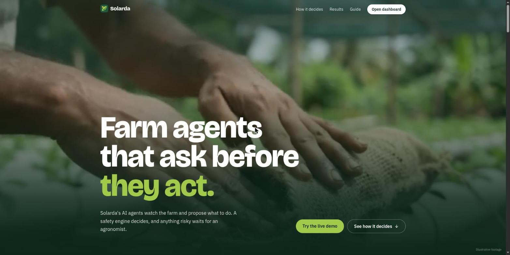
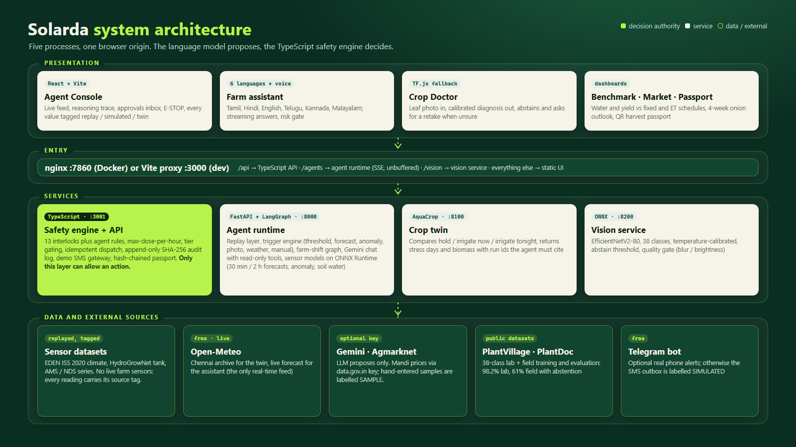

# Solarda: farm agents that ask before they act

[](https://github.com/loktrishal-05/Solar-Da/actions/workflows/ci.yml)


Solarda puts AI agents on a small farm. They watch the data, notice problems and propose irrigation, nutrient, climate and
disease actions in the farmer's language. **They cannot act on their own:** a deterministic safety engine allows, trims or
blocks every proposal, and anything risky waits for an agronomist who signs in to approve it.

Agentic AI Hackathon 2026 · Theme: Agentic AI for Smart Agriculture & Food Security · Team T046 *Unexpectedly_Qualified*



| | |
|---|---|
| **Try it** | `make setup && make dev`, open http://localhost:3000, click *Continue as Farmer*, *Agronomist* or *Admin* |
| **Public URL** | https://solarda.vercel.app (web on Vercel; the backend is a team laptop behind ngrok, so it answers only while that laptop runs) |
| **How it works, for users** | the in-app guide at `/guide`, plus an "About this page" panel on every page |
| **Every number and its source** | [`evidence/README.md`](evidence/README.md) |
| **Security design** | [`SECURITY.md`](SECURITY.md) |

## The problem
Smallholder farms make dozens of decisions a day about water, nutrients and disease with few sensors and no agronomist nearby.
Mistakes waste scarce water or lose a crop. A heat spike, a failing probe or a diseased leaf needs a response in minutes, not at
the next scheduled check. AI could help, but a language model can be wrong or manipulated, and a pump or a chemical dose cannot
depend on its answer. Most advisory apps also speak only English.

## How Solarda solves it
1. **Notice.** Triggers (a limit crossed, an impossible reading, a forecast, a leaf photo, rain ahead, a button) wake the agents at once.
2. **Propose.** Specialist agents for irrigation, fertigation, climate and disease (LangGraph) read the last 24 hours and propose
   actions with reasons. The irrigation agent first tries *wait / water now / water tonight* in an AquaCrop crop twin.
3. **Decide.** The TypeScript safety engine checks 13 rules and allows, modifies or vetoes. The LLM cannot override it; if the
   engine is down, everything is vetoed.
4. **Approve.** Treatments, large doses and every action at autonomy level L1 wait for a signed-in agronomist, whose name is recorded.
5. **Act and record.** Dispatch is idempotent, effects are verified, and everything lands in a hash-chained audit log.

Farmers talk to it by text or voice in Tamil, Hindi, Telugu, Kannada, Malayalam or English. The assistant never gives chemical
doses; it escalates to an expert. The leaf model abstains and asks for a better photo instead of guessing.

## Who uses it
| Role | Can |
|---|---|
| Farmer | See what the agent noticed and did, run scenarios, ask the assistant, check a leaf photo, set the autonomy level |
| Agronomist | Everything a farmer can, plus approve or reject actions the safety engine sent to a person, and clear the E-stop |
| Admin | Everything above, plus manage users and grant the agronomist role (new accounts are always farmers) |

Pages: Overview · Agent console · Approvals · Crop doctor · Farm assistant · Try to break it · Water and market · Alerts ·
Community (sample content) · Settings · Users (admins) · Guide.

## How it meets the judging criteria

**Problem alignment.** Targets the theme's core needs (crop monitoring, disease detection, irrigation, resource optimisation)
for users with little data and no expert nearby: event-driven agents, a crop twin for water decisions, an abstaining disease
model, multilingual voice, and a person in the loop for anything risky. Results are measured against real baselines (below).

**Code quality.** Strict TypeScript and Python, each service with one job; ESLint and Ruff clean (`make lint`, also in CI);
shared zod contracts between the API, the agents and the web app; dead code removed (68 unused components, listed in `docs/AUDIT.md`).

**Security.** Deterministic safety engine; role-based sign-in with scrypt and signed cookies; per-email sign-in limits; only the
agent runtime can dispatch or write the audit log; hash-chained audit log; security headers, no CORS, JSON errors; proxy
allow-list. Details and known limits: [`SECURITY.md`](SECURITY.md).

**Testing.** 170 automated tests run on every push: engine 20, API 47 (auth, approvals, guards, headers, audit chain, red-team
cases), contracts 10, proxy 2, agents 80, crop twin 4, vision 7. CI also replays 30 red-team attacks with promptfoo.
`make test` runs the same suites locally.

**Efficiency.** Pages load on demand: a first visit downloads 208 kB of JavaScript (67 kB compressed), down from 2.4 MB;
three.js loads only on the sign-in page on wide screens. ONNX models run on CPU (about 0.07 s per leaf photo) and the whole
stack fits in about 450 MB of RAM in one container. Agent triggers have cooldowns and an hourly cap.

**Accessibility.** Lighthouse accessibility 100 on all 14 pages (contrast, landmarks, heading order, labelled controls), a
keyboard skip link and visible focus, `prefers-reduced-motion` respected, phone layouts without sideways scrolling, six
languages with voice, a low-bandwidth mode in the assistant, and an offline advisor when there is no internet.

## Results
Simulation and replayed public datasets, not field trials. Each row has a source file and a re-run command in
[`evidence/README.md`](evidence/README.md).

| Claim | Result |
|---|---|
| Irrigation water vs an ET-based controller (Chennai 2021-2023, AquaCrop twin, tomato) | 19-32% less water at about equal yield |
| Red-team attacks (prompt injection, unsafe doses, fake sensor data, Tamil jailbreaks) | 30 / 30 blocked |
| Leaf-disease model | 98.2% on lab photos; on field photos it abstains on 60% and is 87.2% right on the rest |
| Unsafe questions in six languages | 100% escalated (32 cases), no false refusals on 32 safe ones |
| Event-triggered agent vs a fixed 5-10 min schedule | reacts immediately, with fewer runs |
| Cases that did not work (kept on purpose) | pH forecaster, dry-season rain forecast, harvest-date forecast |

## Quick start
Linux or macOS with Node 20+, Python 3.11 through [`uv`](https://docs.astral.sh/uv/), and make:
```bash
make setup    # once: node deps + build, three Python venvs, model weights, local secrets
make dev      # web :3000, API :3001, agents :8000, crop twin :8100, vision :8200
make health   # OK/DOWN per service
make test     # every suite;  make lint;  make stop;  make reset (clear demo runs, keep accounts)
```
Docker: `make docker` (one container on :7860). Windows: `scripts/start_all.ps1`. Presenting from a laptop: double-click **Start Solarda** (`scripts/go_live.ps1`: starts Docker Desktop if needed, runs the container, opens http://localhost:3000; **Stop Solarda** is `scripts/stop_live.ps1`).
Add `-Public` for ngrok on the static domain in the gitignored `.ngrok-domain`; the Vercel proxy `weiqou/web/api/p.js` forwards to it, target set by `BACKEND_URL`.

Optional keys go in a gitignored `.env` (see `.env.example`): `GEMINI_API_KEY` for the LLM (without it the offline advisor
answers), `TELEGRAM_BOT_TOKEN` and `TELEGRAM_CHAT_ID` for phone alerts, `DATA_GOV_API_KEY` for live mandi prices.
Set `SOLARDA_DEMO_LOGIN=0` to switch off the one-click demo accounts on a real deployment.

## Architecture


| Service | Port | Stack | Role |
|---|---|---|---|
| `weiqou/web` | 3000 | React 18, TypeScript, Vite, Tailwind | the product: landing, sign-in, pages; proxies `/api`, `/agents`, `/vision` |
| `weiqou/api` | 3001 | Express, zod, `packages/engine` | **the only place an action can be allowed**; sign-in and roles, approvals, actions, audit log |
| `services/agents` | 8000 | FastAPI, LangGraph, Gemini | replay, triggers, farm-shift graph, sensor models, assistant |
| `services/twin` | 8100 | FastAPI, AquaCrop-OSPy | crop and soil-water simulation |
| `services/vision` | 8200 | FastAPI, ONNX Runtime | leaf-disease classifier, calibrated, abstains |

One farm shift: trigger → ingest (24 h window, data-quality checks) → assess → specialists in parallel → arbiter → safety gate
→ human approval if needed (survives a restart) → dispatch → verify → audit. Diagram: [`docs/img/workflow.png`](docs/img/workflow.png);
details: [`docs/AGENT_LAYER.md`](docs/AGENT_LAYER.md).

## Repository layout
```
packages/engine      safety engine (TypeScript, pure functions) and its tests
packages/contracts   zod contracts shared by API, agents and web; live red-team cases
weiqou/api           Express API: sign-in, approvals, safety endpoints, audit log
weiqou/web           React web app (src/pages, src/shell, src/components); api/p.js is the Vercel proxy
services/agents      agent runtime: replay, triggers, LangGraph graphs, assistant, sensor models
services/twin        AquaCrop crop twin
services/vision      leaf-disease service and its training notebook
data/                replay slices, scenarios, weather, market, knowledge sources (each with attribution)
bench/  evidence/    benchmarks and the evidence behind every number
redteam/             promptfoo attack suites
deploy/  scripts/    Docker entrypoint, nginx, model fetch; Windows and laptop-server scripts
docs/                decisions, audit, agent layer, finale pack (docs/finale)
firmware/            ESP32 sketches for the planned sensor nodes
```

## Data honesty and limitations
- No live farm sensors are connected. Readings are replayed from public datasets or simulated, and always labelled as such.
- The leaf model is an assistant, not a diagnosis; it abstains often on field photos by design, and treatments need a person.
- Safety-envelope numbers are placeholders until an agronomist reviews them.
- SMS is a demo outbox; Telegram works with a bot token. Gemini's free tier limits requests per day.
- Telugu, Kannada and Malayalam have text replies but may lack a browser voice on some systems.

## Documentation
[`docs/DECISIONS.md`](docs/DECISIONS.md) decisions · [`docs/AUDIT.md`](docs/AUDIT.md) what is real, sample or removed ·
[`docs/AGENT_LAYER.md`](docs/AGENT_LAYER.md) agents · [`docs/BLUEPRINT.md`](docs/BLUEPRINT.md) original plan ·
[`docs/finale/`](docs/finale) demo script, slide text, Q&A · [`docs/NEXT.md`](docs/NEXT.md) status ·
[`evidence/README.md`](evidence/README.md) results.

## Team and licence
Harshavardhan K (lead), Kinnera Cholan, Loktrishal K, Sanjjith B · R M K College of Engineering and Technology.

Code: [MIT](LICENSE). Datasets, model weights, fonts and media keep their own licences: [`THIRD_PARTY_NOTICES.md`](THIRD_PARTY_NOTICES.md).
